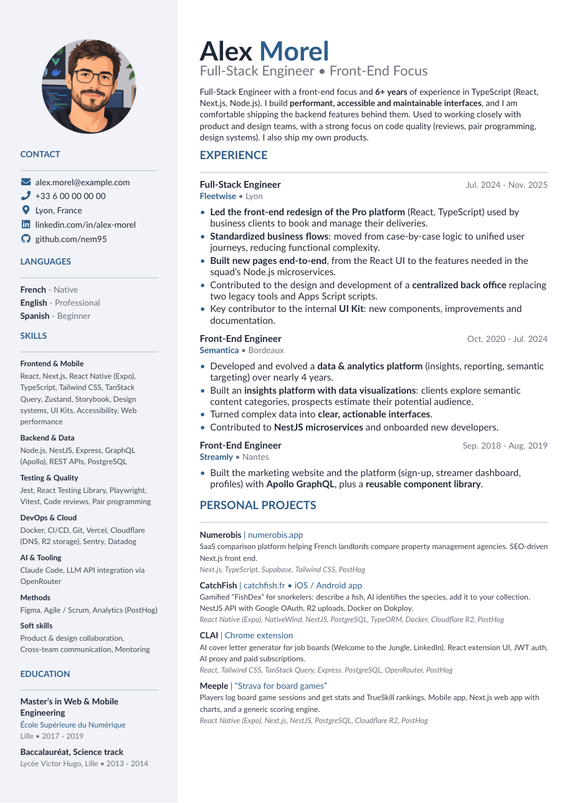
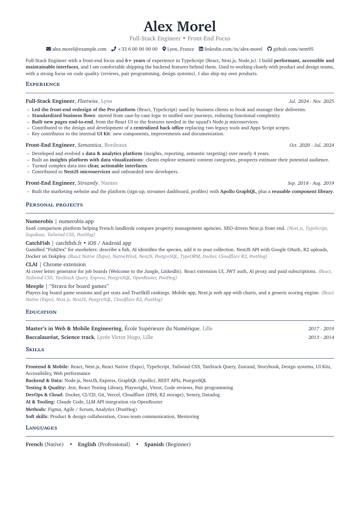
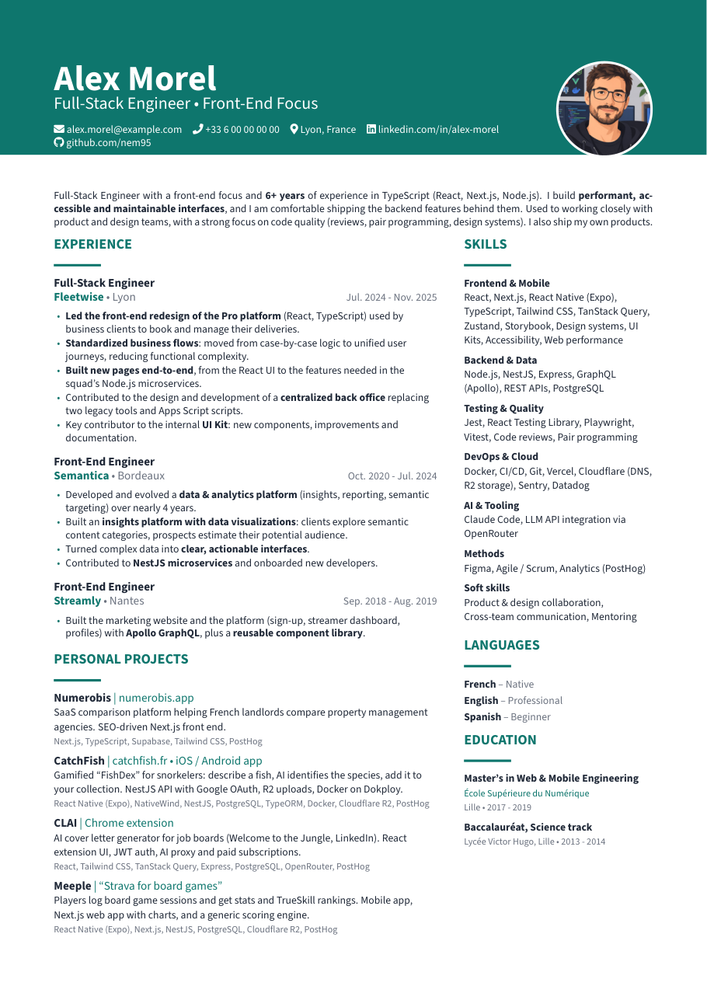
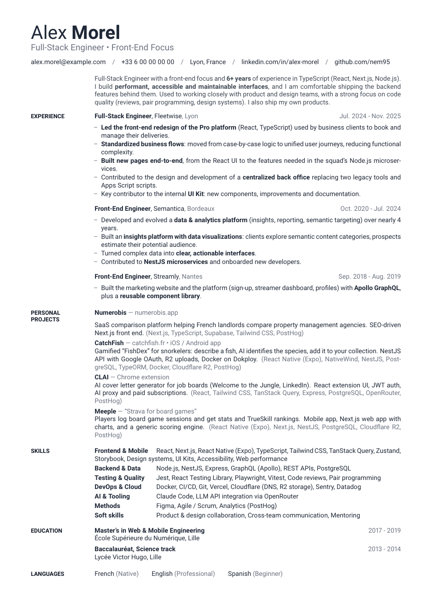
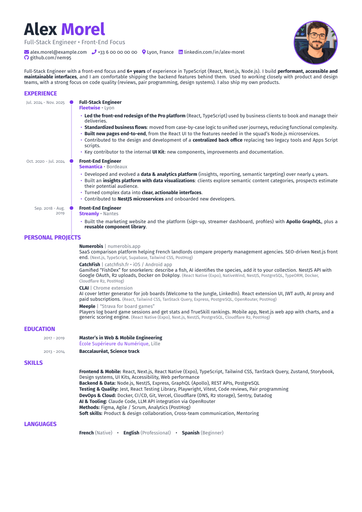
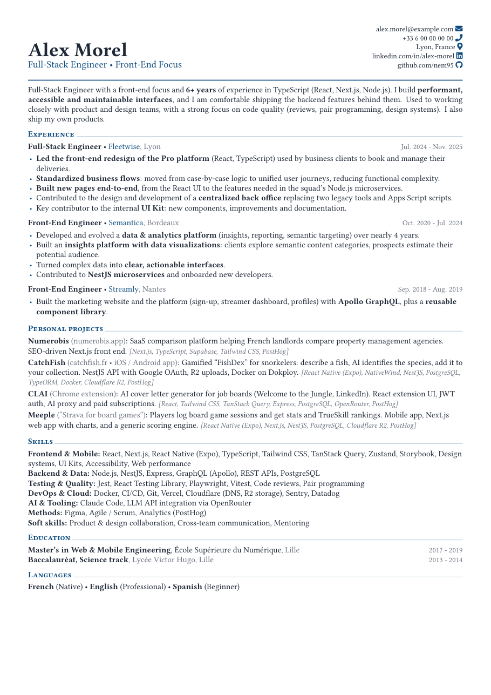
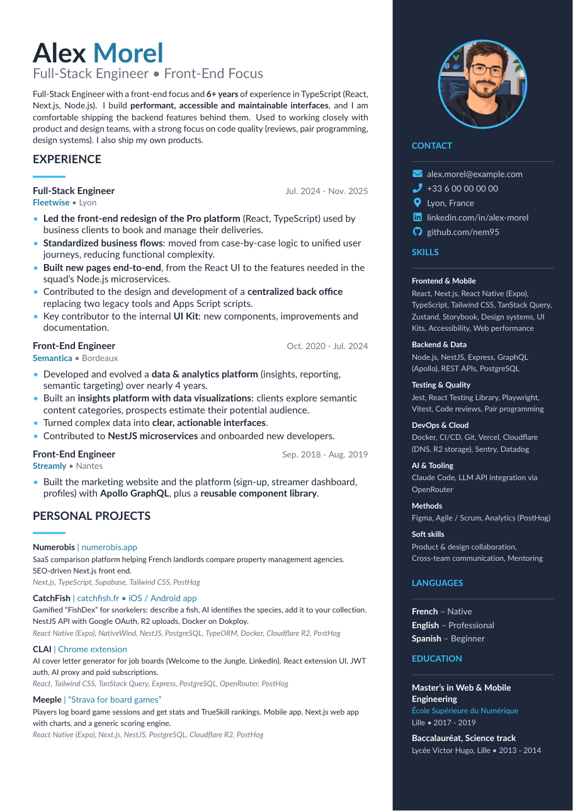
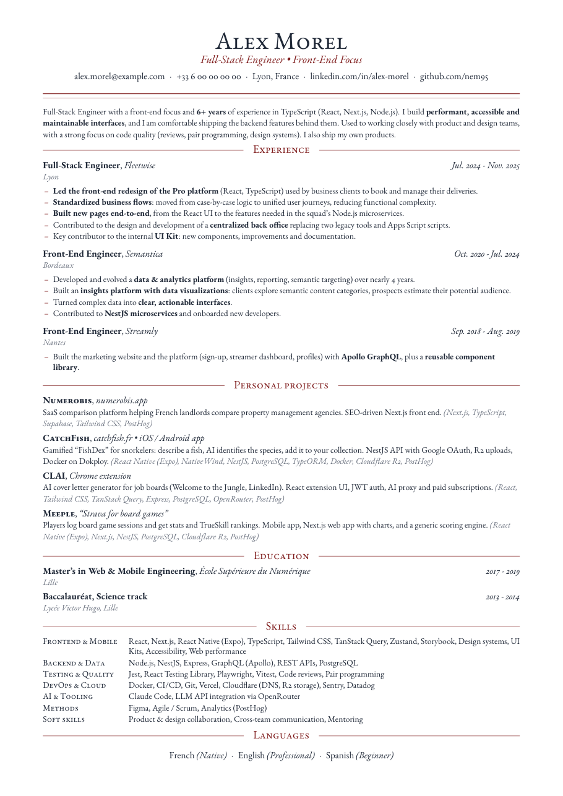
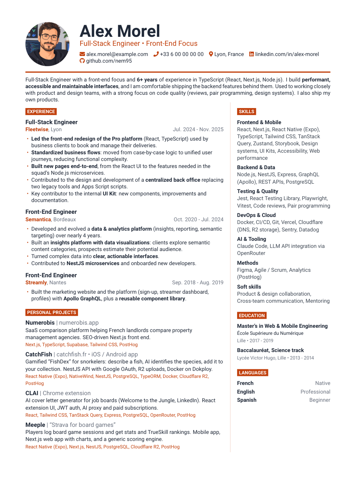
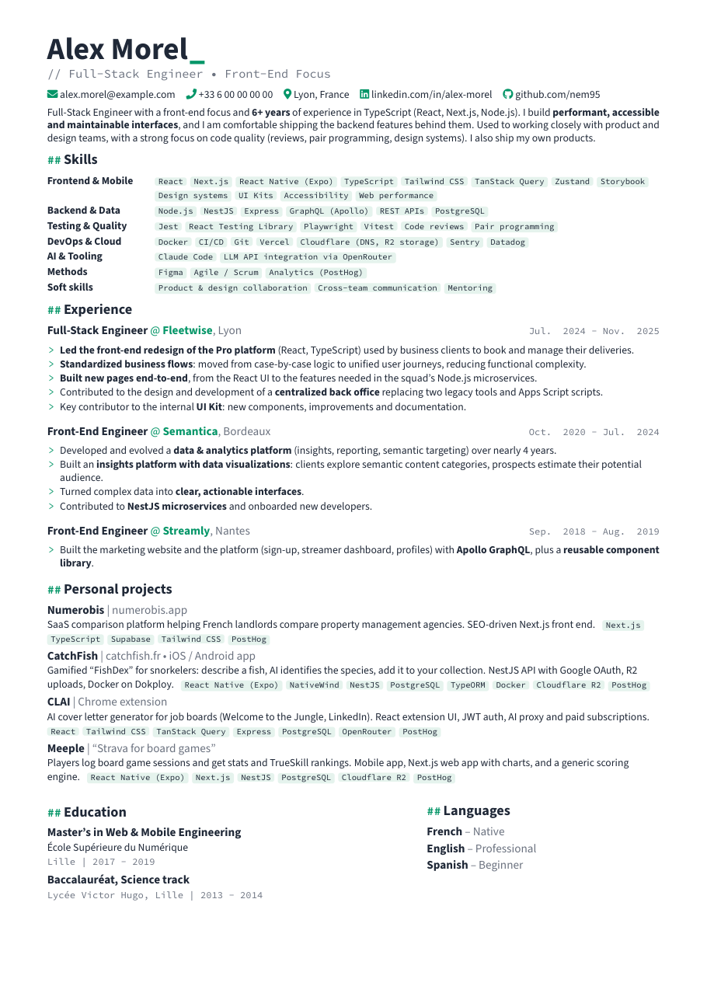

# Example renders

Every template, built from [`example.json`](example.json) (a fictional CV). Click an image to open the PDF.

Rebuild them with `python3 scripts/render_examples.py`.

| **`sidebar`** | **`classic`** |
|---|---|
|  |  |
| Two columns: sidebar (photo, contact, skills) and main column. A4, Lato font. | Single column, serif (XCharter), centered header. Traditional and ATS-friendly. No photo. |

| **`modern`** | **`minimal`** |
|---|---|
|  |  |
| Colored header band with photo, main column and side column. Source Sans. | Swiss style: section titles in the margin, lots of white space, almost no color. Roboto. No photo. |

| **`timeline`** | **`compact`** |
|---|---|
|  |  |
| Experience as a vertical timeline with dates in the margin. Fira Sans, optional photo. | Dense single column with small margins, for long careers. Libertinus serif. No photo. |

| **`dark`** | **`elegant`** |
|---|---|
|  |  |
| Dark sidebar on the right (photo, contact, skills), bright accent color. Lato. | Centered layout, small caps and EB Garamond, ornamental section rules. No photo. |

| **`banner`** | **`tech`** |
|---|---|
|  |  |
| Header with photo, two columns split by a thin rule, section titles as colored tags. Roboto. | Developer look: monospace accents, Markdown-like headings, skills shown as tags. No photo. |
